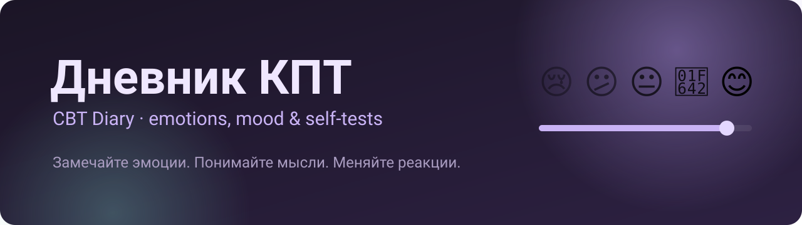
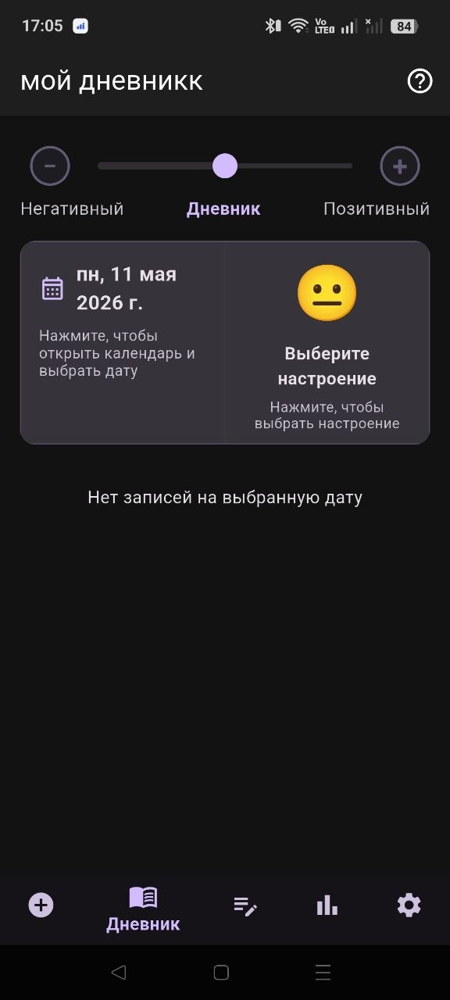
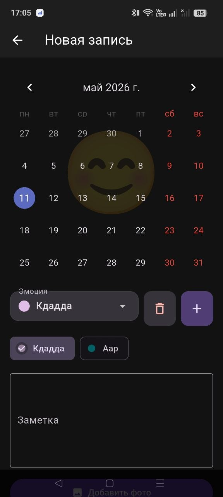
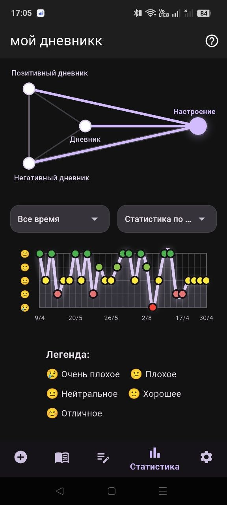
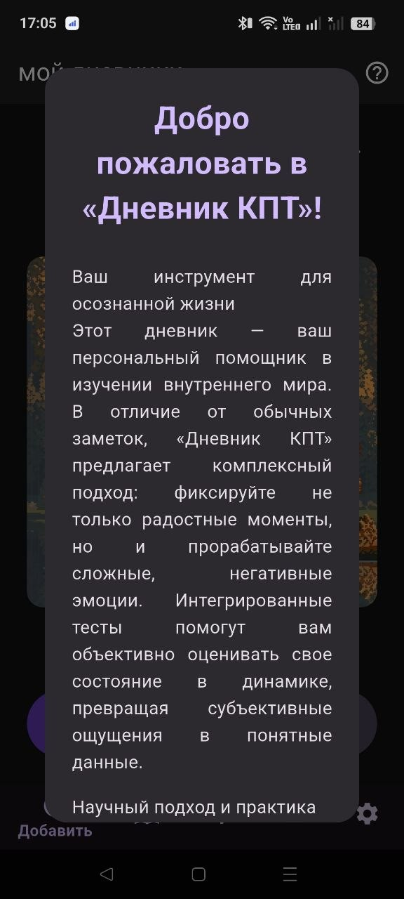
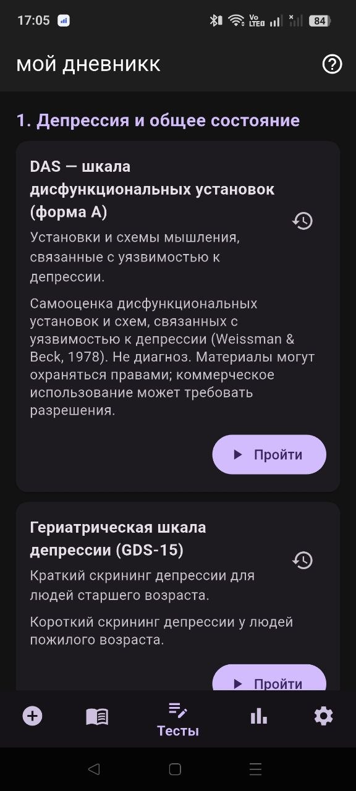
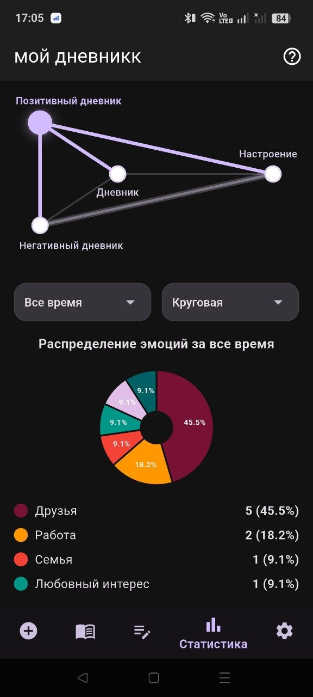
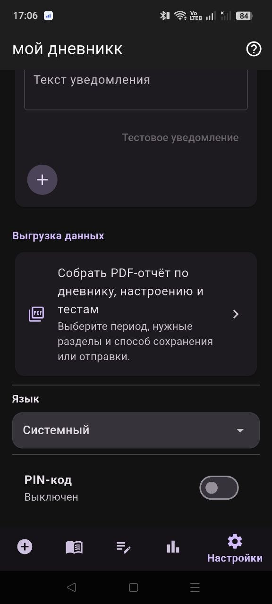
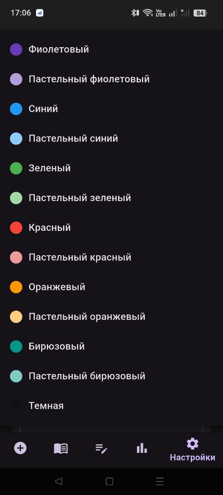
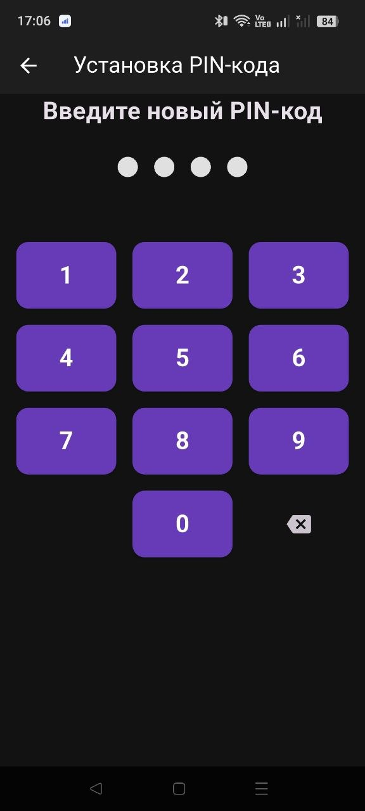

<p align="center">
  
</p>

<p align="center">
  
  
  
  
  
</p>

<p align="center">
  <b>🇷🇺 <a href="#-русский">Русский</a></b> &nbsp;·&nbsp; <b>🇬🇧 <a href="#-english">English</a></b> &nbsp;·&nbsp; <b>📦 <a href="../../releases">Скачать APK / Download</a></b>
</p>

<p align="center">
  
  &nbsp;
  
  &nbsp;
  
</p>

---

## 🇷🇺 Русский

> **Дневник КПТ** — карманный инструмент когнитивно-поведенческой терапии.
> Минута в день, чтобы заметить свои эмоции, понять, откуда они берутся, и увидеть, как меняется ваше состояние.

### 💡 Почему это важно

По данным ВОЗ, с психическими расстройствами живёт **примерно каждый восьмой человек в мире**, а тревога и депрессия — самые частые из них. Стресс, перегрузка и выгорание стали фоном повседневной жизни, и всё больше людей ищут **простые и доступные способы заботиться о себе** — до того, как станет совсем тяжело.

**Когнитивно-поведенческая терапия (КПТ)** — одно из наиболее изученных и признанных направлений психотерапии с доказанной эффективностью при тревоге и депрессии. Её ключевая идея: **эмоции зависят не столько от событий, сколько от того, как мы их интерпретируем**. А первый шаг любой КПТ-работы — **регулярное самонаблюдение**: записывать, что произошло, что вы почувствовали и насколько сильно.

Именно это и делает приложение — превращает самонаблюдение в лёгкую ежедневную привычку.

### 🧠 Как в приложении работает КПТ

| Принцип КПТ | Как это реализовано |
|---|---|
| **Самонаблюдение** | Дневник с датой, эмоциями и заметкой — фиксируйте, что произошло и что вы чувствовали |
| **Работа с негативными эмоциями** | Отдельный *негативный дневник*, чтобы спокойно разбирать сложные переживания |
| **Опора на ресурсы** | *Позитивный дневник* — замечать и сохранять хорошее, а не только проблемы |
| **Объективная оценка** | Валидированные психологические опросники вместо «мне кажется» |
| **Отслеживание динамики** | Графики настроения и эмоций — видно, что меняется со временем |
| **Работа со специалистом** | PDF-отчёт, который можно показать психологу или психотерапевту |

### ⚡ Запись за 30 секунд

Приложение сделано так, чтобы ежедневная запись не превращалась в обязанность:

1. **Откройте** — главный экран сразу показывает сегодняшний день.
2. **Выберите настроение** одним касанием по шкале 😢 → 😊 — или добавьте эмоции и пару слов.
3. **Готово.** Настроение сохраняется сразу после выбора, запись — одной кнопкой.

🔔 **Напоминание** в удобное время мягко подскажет не пропустить день — время и текст настраиваются.

### 🎨 Спокойный дизайн, который не отталкивает

- **Тёмная тема и мягкие пастельные цвета** — интерфейс не утомляет глаза и не давит, даже вечером.
- **12 цветовых тем** — от фиолетового и бирюзового до пастельных оттенков.
- **Ничего лишнего** — пять понятных вкладок: добавить · дневник · тесты · статистика · настройки.
- **Приветственные картинки** — пейзажи или котики при входе, чтобы начинать запись с улыбки.
- **Подсказки «?»** на экранах — объясняют, как пользоваться функциями.

### ✨ Возможности

| | |
|---|---|
| 📔 **Три дневника** | общий, позитивный и негативный — переключение одним ползунком |
| 🎭 **Эмоции** | готовый каталог эмоций, свои эмоции, несколько эмоций в одной записи, заметка и фото |
| 🙂 **Настроение дня** | пятибалльная шкала от «очень плохо» до «отлично» |
| 📋 **Психологические тесты** | депрессия, тревога и паника, стресс и травма, биполярный спектр, СДВГ, сон: BAI, LSAS, DAS, GDS-15, IES-R, CPSS, ASRS, BSDS, PSQI и др. — с историей результатов |
| 📊 **Статистика** | круговые диаграммы эмоций и график настроения за любой период |
| 📄 **PDF-отчёт** | дневник, настроение и тесты за выбранный период — сохранить или отправить |
| 🔔 **Напоминания** | ежедневные, со своим временем и текстом |
| 🔒 **PIN-код** | дневник личный — и останется личным |
| 🌍 **5 языков** | русский, английский, немецкий, французский, португальский |

### 🔐 Приватность

Все записи хранятся **только на вашем устройстве**. Приложению не нужен аккаунт, и оно не отправляет ваши данные в интернет. Дополнительно дневник можно закрыть PIN-кодом.

### 📸 Скриншоты

| | | |
|:-:|:-:|:-:|
| <br>**Приветствие** | <br>**Дневник** | <br>**Новая запись** |
| <br>**Тесты** | <br>**Статистика эмоций** | <br>**График настроения** |
| <br>**Настройки** | <br>**Цветовые темы** | <br>**PIN-код** |

### 📲 Установка

1. Откройте [**Releases**](../../releases) и скачайте `psih-dnevnik-v1.0.0.apk`.
2. Запустите файл на телефоне. Если Android спросит — разрешите установку из этого источника.

<details>
<summary><b>🛠 Сборка из исходников</b></summary>

<br>

Нужны [Flutter](https://docs.flutter.dev/get-started/install) (stable, Dart ≥ 3.2.3) и Android SDK.

```bash
git clone https://github.com/lordAlehandro/psih.dnevnik.git
cd psih.dnevnik
flutter pub get
flutter run          # запуск на устройстве / эмуляторе
flutter build apk    # APK → build/app/outputs/flutter-apk/
```

Для release-подписи создайте `android/key.properties` (в репозитории не хранится):

```properties
storePassword=...
keyPassword=...
keyAlias=...
storeFile=путь/к/keystore.jks
```

**Технологии:** Flutter · Dart · SQLite (`sqflite`) · `shared_preferences` · `flutter_secure_storage` · `fl_chart` · `table_calendar` · `pdf` + `printing` · `flutter_local_notifications` · `share_plus`

</details>

> [!IMPORTANT]
> Приложение — инструмент самопомощи и самонаблюдения. Результаты тестов **не являются диагнозом** и не заменяют консультацию специалиста. Если вам тяжело — обратитесь к психологу, психотерапевту или на линию психологической помощи.

---

## 🇬🇧 English

> **CBT Diary** is a pocket tool based on Cognitive Behavioral Therapy.
> One minute a day to notice your emotions, understand where they come from, and see how your well-being changes over time.

### 💡 Why it matters

According to the WHO, **about one in eight people worldwide lives with a mental disorder**, with anxiety and depression being the most common. Stress, overload and burnout have become part of everyday life, and more and more people are looking for **simple, accessible ways to take care of themselves** — before things get really hard.

**Cognitive Behavioral Therapy (CBT)** is one of the most researched and widely recognized forms of psychotherapy, with proven effectiveness for anxiety and depression. Its core idea: **emotions depend less on events themselves than on how we interpret them**. And the first step of any CBT work is **regular self-monitoring** — writing down what happened, what you felt, and how strongly.

That's exactly what this app does: it turns self-monitoring into an easy daily habit.

### 🧠 How CBT works in the app

| CBT principle | How it's implemented |
|---|---|
| **Self-monitoring** | A diary with date, emotions and a note — record what happened and how you felt |
| **Working through negative emotions** | A separate *negative diary* to calmly unpack difficult experiences |
| **Building on resources** | A *positive diary* — notice and keep the good things, not just the problems |
| **Objective assessment** | Validated psychological questionnaires instead of "I guess" |
| **Tracking progress** | Mood and emotion charts show what changes over time |
| **Working with a therapist** | A PDF report you can share with your psychologist or therapist |

### ⚡ An entry in 30 seconds

The app is designed so that daily journaling never feels like a chore:

1. **Open it** — the main screen already shows today.
2. **Pick your mood** with one tap on the 😢 → 😊 scale — or add emotions and a few words.
3. **Done.** Your mood is saved the moment you pick it; an entry takes one tap to save.

🔔 A **reminder** at a time that suits you gently nudges you not to skip a day — both time and text are customizable.

### 🎨 Calm design that feels welcoming

- **Dark theme and soft pastel colors** — easy on the eyes and never overwhelming, even late in the evening.
- **12 color themes** — from violet and teal to gentle pastel shades.
- **Nothing extra** — five clear tabs: add · diary · tests · statistics · settings.
- **Welcome images** — landscapes or cats on launch, so every entry starts with a smile.
- **"?" hints** on screens explain how each feature works.

### ✨ Features

| | |
|---|---|
| 📔 **Three diaries** | general, positive and negative — switch with a single slider |
| 🎭 **Emotions** | built-in emotion catalog, your own emotions, several emotions per entry, a note and a photo |
| 🙂 **Daily mood** | a five-point scale from "very bad" to "excellent" |
| 📋 **Psychological tests** | depression, anxiety & panic, stress & trauma, bipolar spectrum, ADHD, sleep: BAI, LSAS, DAS, GDS-15, IES-R, CPSS, ASRS, BSDS, PSQI and more — with result history |
| 📊 **Statistics** | emotion pie charts and a mood chart for any period |
| 📄 **PDF report** | diary, mood and tests for a chosen period — save or share |
| 🔔 **Reminders** | daily, with your own time and message |
| 🔒 **PIN code** | your diary is private — and stays private |
| 🌍 **5 languages** | Russian, English, German, French, Portuguese |

### 🔐 Privacy

All entries are stored **only on your device**. No account is required, and the app does not send your data anywhere. You can additionally lock the diary with a PIN.

### 📸 Screenshots

*(The app interface in the screenshots is in Russian.)*

| | | |
|:-:|:-:|:-:|
| <br>**Welcome** | <br>**Diary** | <br>**New entry** |
| <br>**Tests** | <br>**Emotion statistics** | <br>**Mood chart** |
| <br>**Settings** | <br>**Color themes** | <br>**PIN code** |

### 📲 Installation

1. Go to [**Releases**](../../releases) and download `psih-dnevnik-v1.0.0.apk`.
2. Open the file on your phone. If Android asks, allow installing from this source.

<details>
<summary><b>🛠 Building from source</b></summary>

<br>

Requires [Flutter](https://docs.flutter.dev/get-started/install) (stable, Dart ≥ 3.2.3) and the Android SDK.

```bash
git clone https://github.com/lordAlehandro/psih.dnevnik.git
cd psih.dnevnik
flutter pub get
flutter run          # run on a device / emulator
flutter build apk    # APK → build/app/outputs/flutter-apk/
```

For release signing, create `android/key.properties` (not stored in the repository):

```properties
storePassword=...
keyPassword=...
keyAlias=...
storeFile=path/to/keystore.jks
```

**Tech stack:** Flutter · Dart · SQLite (`sqflite`) · `shared_preferences` · `flutter_secure_storage` · `fl_chart` · `table_calendar` · `pdf` + `printing` · `flutter_local_notifications` · `share_plus`

</details>

> [!IMPORTANT]
> This app is a self-help and self-monitoring tool. Test results **are not a diagnosis** and do not replace professional advice. If you're struggling, please reach out to a psychologist, therapist or a mental health helpline.
